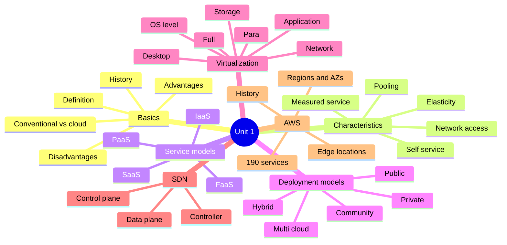
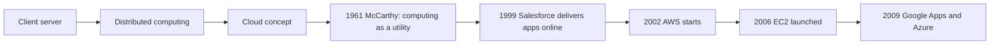
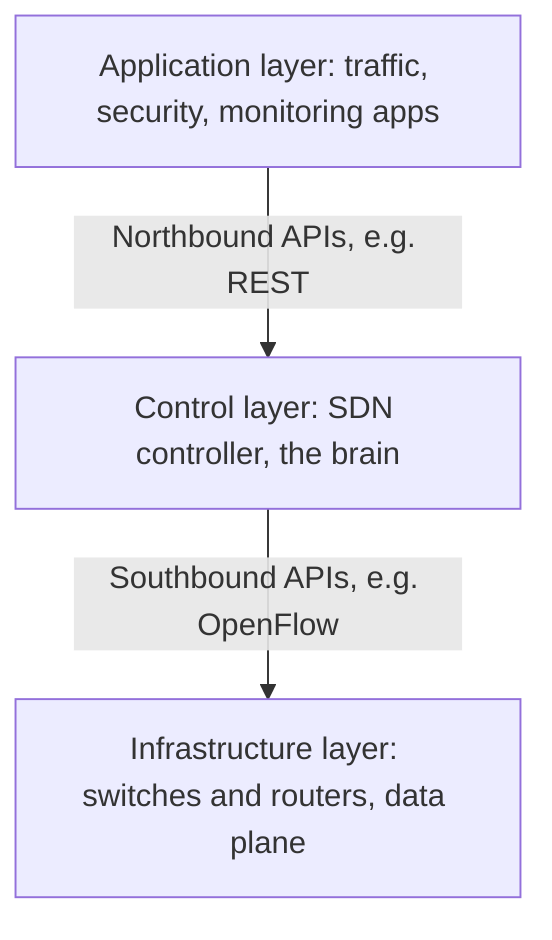
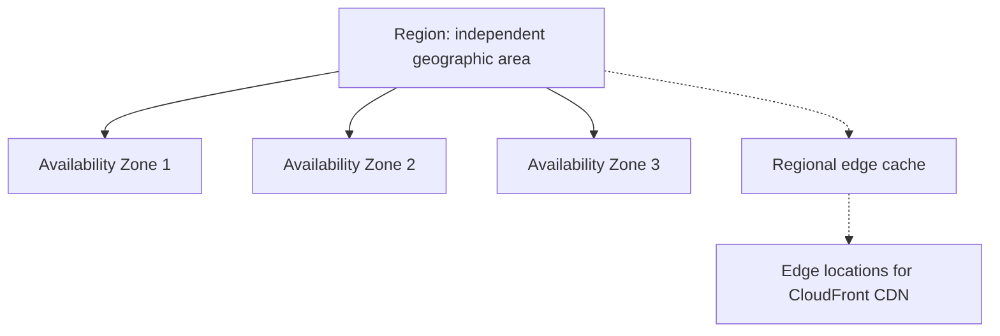
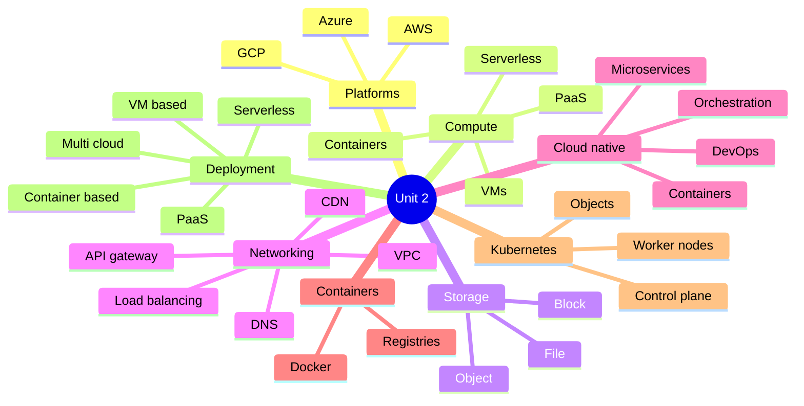
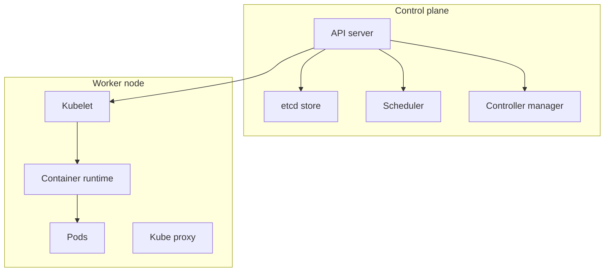
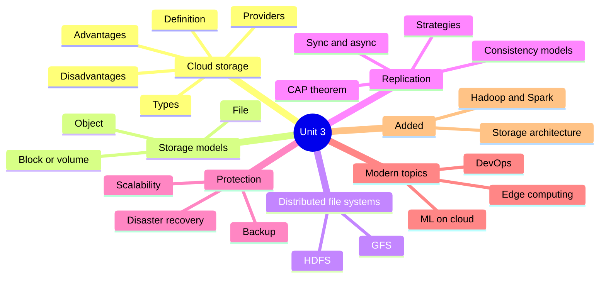
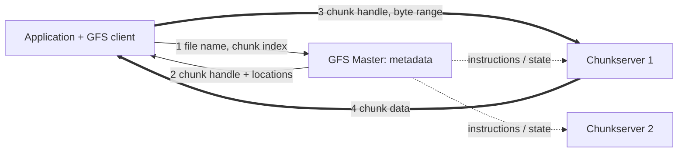
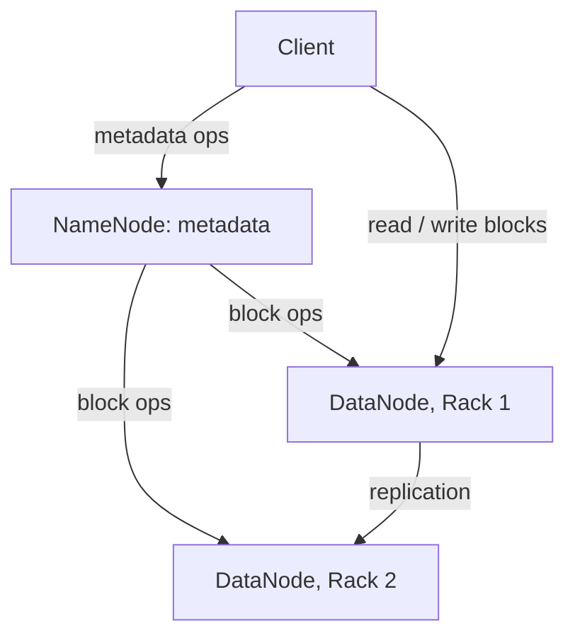

# Cloud Computing: Study Material from the New PDFs

*Built from **Unit_1_CC** (intro, models, virtualization, SDN, Kubernetes, AWS) and **UNIT_2** ("Cloud Services and Platforms": AWS/Azure/GCP, compute, storage, networking, cloud-native, containers, Kubernetes, deployment). Where these differ from your earlier Cloud Deployment notes, see the last section.*

---

# PART A: Unit 1

## Mind map

## 1. Introduction

- Cloud computing = delivery of **on-demand computing services** (servers, storage, databases, networking, software, analytics, intelligence) over the Internet, **pay-as-you-go**.
- It is an **alternative to the on-premises data center**. On-premises means you buy hardware, set up virtualization, OS, network, firewall, and storage, and maintain all of it for its whole life. In the cloud, the **vendor buys and maintains hardware**, and you rent services and pay by usage through an online portal.

## 2. Advantages and disadvantages

| Advantages | Disadvantages |
| --- | --- |
| **Cost:** removes huge capital cost of hardware and software | **Needs good Internet** and bandwidth at all times |
| **Speed:** resources in minutes, a few clicks | **Downtime:** outage means business loss |
| **Scalability:** increase or decrease as business needs | **Limited control** of infrastructure |
| **Productivity:** no patching or hardware upkeep, IT team focuses on business goals | **Limited flexibility** and **vendor lock-in** (migration causes compatibility, interoperability, support issues) |
| **Reliability:** cheaper, faster backup and recovery | **Ongoing costs:** you keep paying while you use (traditional is mostly one-time) |
| **Security:** vendors offer broad policies, technologies, controls | **Security:** public cloud uses the Internet, so data may be vulnerable, choose a compliant provider |
|  | **Technical issues:** not all vendors give 24/7 support |

## 3. Conventional computing vs cloud computing

| Conventional | Cloud |
| --- | --- |
| More time to install, set up, configure | Faster access once the environment is set up |
| Cost paid in advance | Pay-as-you-go |
| Cost is fixed | Cost is variable |
| Economic to scale for all organizations | Economic to scale mainly for large organizations |
| Scaling needs manual effort | Scaling is elastic and automatic |
| Mix of physical and virtualized | Usually virtualized |

## 4. History

- **Client/server:** centralized, all software, data, and control on the server side.
- **Distributed computing:** networked computers share resources.
- **1961:** John McCarthy suggested at MIT that computing could be sold like water or electricity. The technology was not ready yet.
- **1999** Salesforce.com delivered enterprise applications through a website. **2002** Amazon started AWS. **2006** Elastic Compute Cloud (EC2) made a truly commercial service open to everybody. **2009** Google Apps and Microsoft Windows Azure arrived (your UNIT_2 PDF gives 2010 for Azure). Oracle and HP also joined.

## 5. Characteristics (5, NIST)

| Characteristic | Meaning |
| --- | --- |
| **On-demand self-service** | Consumer provisions server time and storage automatically, without human interaction with the provider |
| **Broad network access** | Available over the network through standard mechanisms on thin or thick clients (phones, tablets, laptops, workstations) |
| **Resource pooling** | Provider's resources pooled for many consumers (multi-tenant), assigned and reassigned dynamically. Location independence: customer can usually choose only country, state, or data center |
| **Rapid elasticity** | Resources provisioned and released (sometimes automatically) to scale outward and inward with demand. Looks unlimited to the consumer |
| **Measured service** | Metering at an appropriate level (storage, processing, bandwidth, active users). Usage is monitored, controlled, reported, transparent to both sides |

**Distributed systems vs cloud:** distributed systems are independent computers working together, often tightly coupled. Cloud abstracts infrastructure, adds elasticity, utility billing, and managed services. Key difference: cloud adds **service delivery and business model layers** beyond distributed computing.

## 6. Service models

| Model | Definition | Users |
| --- | --- | --- |
| IaaS | Rent servers, storage, networking | IT admins |
| PaaS | Platform for app development (runtime, DB) | Developers |
| SaaS | Software delivered via browser | End users |
| **FaaS** | Serverless functions triggered by events | Developers |

**Stack:** Client (browser, mobile app, thin client) → **SaaS** (CRM, email, virtual desktop, games) → **PaaS** (runtime, databases, web servers, dev tools) → **IaaS** (VMs, servers, storage, load balancers, network).

**IaaS:** provider hosts hardware, servers, storage and handles maintenance, backup, resiliency planning. Highly scalable, good for temporary, experimental, or unpredictable workloads. Features: automation of admin tasks, dynamic scaling, desktop virtualization, policy-based services. Open-source frameworks like **OpenStack** help build private or public clouds.

- **IaaS network services:** **load balancing** (single access point to many servers, distributes traffic by algorithms) and **DNS** (hierarchical naming system mapping domain names to IP addresses).

**PaaS:** provider supplies hardware and software tools (usually for application development). Users log in through a browser, pay per use or monthly. Characteristics: scalability and auto-provisioning, security and redundancy, build and deployment tools, integration with web services, databases, LDAP, multi-tenancy, logging and reporting, management interfaces and APIs.

**SaaS:** applications hosted by the vendor and delivered over a network. Benefits: easier administration, automatic updates and patching, **same version for all users** (compatibility), easier collaboration, global accessibility. Related to ASP and on-demand computing.

## 7. Deployment models

| Model | Key points | Examples |
| --- | --- | --- |
| **Private** | Operated solely for one organization. **On-site** (at customer premises) or **outsourced** (hosted and managed by a third party) | Eucalyptus, Ubuntu Enterprise Cloud, Amazon VPC, VMware Cloud Infrastructure Suite |
| **Community** | Shared by several organizations with shared concerns (mission, security, policy, compliance). Also on-site or outsourced. Used by government departments, universities, central banks | Google Apps for Government, Microsoft Government Community Cloud |
| **Public** | Available to the general public or a large industry group, owned by a cloud-selling organization. Almost a synonym for cloud | Google App Engine, Azure, IBM SmartCloud, Amazon EC2 |
| **Hybrid** | Two or more clouds stay separate but are bound by standard or proprietary technology for data and application portability (e.g. **cloud bursting** for load balancing) | Azure, VMware vCloud |

Also listed: **Multi-cloud** (multiple providers) and **Hybrid multi-cloud** (hybrid + multi-cloud together).

**Cloud reference architecture (layers):** Physical infrastructure → Virtualization → Cloud services (IaaS, PaaS, SaaS) → Management and orchestration → Security and compliance.

## 8. Virtualization

**Idea:** change the mindset from physical to logical. Create many logical (virtual) systems inside one physical system. A **hypervisor** (software that virtualizes hardware) manages resources for every virtual system.

**Benefits:** flexible and efficient resource allocation, better development productivity, lower IT cost, remote access and rapid scalability, high availability and disaster recovery, pay-per-use, runs multiple operating systems.

### Types by what is virtualized

| Type | Meaning |
| --- | --- |
| **Application** | Remote access to an application from a server, which stores its data and settings but runs on the local workstation. Example: running two versions of the same software |
| **Network** | Many virtual networks on one physical network, each with its own control and data plane. Logical switches, routers, firewalls, load balancers, VPN |
| **Desktop** | User's OS stored on a data center server, accessed from any location and device. Benefits: mobility, portability, easy management of installs, updates, patches |
| **Storage** | Many storage devices managed as a single repository. Servers do not know where data physically lives |

### Types by technique

| Technique | How it works | Examples |
| --- | --- | --- |
| **Full: software assisted** (binary translation) | Traps and virtualizes sensitive instructions using binary translation. Guest OS unmodified. Criticized for performance | VMware Workstation (32-bit guests), Virtual PC, VirtualBox (32-bit), VMware Server |
| **Full: hardware assisted** | No binary translation. Uses processor support (Intel VT-x, AMD-V, since 2005). Guest OS unmodified | **Type 1:** VMware ESXi, KVM, Hyper-V, Xen. **Type 2:** VMware Workstation and VirtualBox (64-bit guests) |
| **Paravirtualization** | Hypervisor on the host, guest OS **knows** it is virtualized. Guest kernel is **modified** to make API calls (hypercalls) to the hypervisor | Xen, IBM LPAR, Oracle VM for SPARC and x86 |
| **Hybrid** (HW virtualized with PV drivers) | Full virtualization plus paravirtual drivers for I/O and memory-heavy workloads, to cut VM traps and CPU overhead | Oracle VM for x86, Xen, VMware ESXi |
| **OS-level (containerization)** | Host kernel runs multiple isolated user spaces (instances). Very little or no overhead | Solaris Zones, Linux LXC, Docker, AIX WPAR |

**Hypervisors:** Type 1 (bare-metal) runs on hardware, e.g. ESXi. Type 2 (hosted) runs on an OS, e.g. VirtualBox. Containers are lightweight and faster than VMs.

## 9. Software Defined Networking (SDN)

**Definition:** a network management approach that uses software controllers to centrally and dynamically control network behavior. It **separates the control plane (decisions) from the data plane (packet forwarding)**.

**Need for SDN:** traditional networks use individually configured devices, which is complex and inflexible. SDN gives **centralized control**, **programmability** (automation, fewer errors), and **flexibility and agility**.

| Feature | Control plane | Data plane |
| --- | --- | --- |
| Purpose | Decision making and control logic | Forwarding of data packets |
| Function | Determines routing paths and policies | Forwards packets by given rules |
| Location | Centralized in the SDN controller | Switches and routers |
| Decisions | Makes forwarding and traffic decisions | Follows instructions only |
| View | Global view of network | Local device-level view |
| Programmability | High | Limited |

**Components:** SDN applications (define policy), SDN controller (global view, translates policy to rules), SDN networking devices (physical or virtual switches and routers).

**Implementation models**

1. **Open SDN:** standard protocols like OpenFlow, "dumb" switches, intelligence in controller, vendor neutral.
2. **API-based SDN:** devices expose APIs (REST, gRPC, NETCONF) for configuration.
3. **Overlay SDN:** virtual networks on top of existing physical ones using tunnels (VXLAN, NVGRE, GRE), multi-tenant, no change to hardware.
4. **Hybrid SDN:** SDN with traditional protocols (OSPF, BGP) together, for gradual migration.

| Traditional networking | SDN |
| --- | --- |
| Control and data plane combined in each device | Control plane separated and centralized |
| Manual, device-by-device | Automated, centralized |
| CLI configuration, slow and error-prone | APIs, fast and flexible |
| Limited scalability | High scalability |
| Mostly fixed behavior | Dynamic, software-controlled |
| Vendor interoperability issues | Vendor-neutral protocols |
| Slow fault recovery | Controller reroutes quickly |
| Upgrades need costly hardware | New services via software |

**Advantages:** centralized control, automation, programmability, flexibility, scalability, cost efficiency (commodity hardware), better fault handling, faster innovation. **Disadvantages:** controller is a **single point of failure**, controller can become a bottleneck, resilience depends on controller failover, migration complexity, controller is a high-value security target. **Applications:** data centers, cloud networking, traffic management, network virtualization, security.

## 10. Kubernetes (intro, details in Part B)

- Open-source container orchestration (K8s), developed by Google (from Borg and Omega), released 2014, donated to CNCF in 2015. Name is Greek for "helmsman".
- **Why:** Docker packages apps well, but at hundreds of containers you hit scalability, multi-cloud, security and resource management, and rolling update problems.
- **Features:** automated scheduling, self-healing, rollouts and rollbacks, scaling and load balancing, resource optimization.
- **Monolithic → microservices:** a monolith needs a full redeploy for any change and one bug can crash everything. Microservices deploy independently, but then thousands of small containers must be orchestrated, which K8s does.
- **Terms:** Pod, Node, Cluster (master or control plane + workers), Deployment, ReplicaSet, Service, Ingress, ConfigMap, Secret, Persistent Volume, Kubelet, Kube-proxy.

## 11. AWS

**History timeline**

- **2002** AWS platform launched (few disparate tools). **Late 2003** Pinkham and Black presented a standardized, automated, web-service-based infrastructure vision and the idea of selling virtual servers.
- **Nov 2004** first public service: **SQS**. **14 March 2006** official relaunch with **S3, SQS, EC2**.
- **2013** certification program. **2014** AWS Partner Network (APN). **2015** acquired Annapurna Labs. **2016** Andy Jassy became CEO of AWS. **2018** auto scaling, custom ARM cores, ground stations for satellites.

**Global infrastructure**

| Component | Key points |
| --- | --- |
| **Availability Zone (AZ)** | Physical data centers hosting your compute, storage, network, database resources (inside VPCs). One AZ is usually **several data centers** close together. AZs in a region are linked by low-latency private fiber but have **separate power and network**, so one failure does not spread. Use **at least two AZs** for high availability |
| **Region** | Collection of AZs close together (same city area). Each region is independent and has at least two AZs. Pick by latency to customers and data-location laws. Multiple regions help global organizations |
| **Edge location** | Sites in major cities, far more than AZs. Not for EC2, EBS, VPC, RDS. Used by **CloudFront** (and Lambda@Edge) as a CDN to cache content and cut latency |
| **Regional edge cache** | Announced Nov 2016. Sits between CloudFront origin servers and edge locations, has larger cache, so edge locations fetch from it instead of the slower origin |

**AWS services:** about **190 services in 24 categories** (Analytics, Application Integration, AR and VR, Cost Management, Blockchain, Business Applications, Compute, Customer Engagement, Database, Developer Tools, End User Computing, Game Tech, IoT, Machine Learning, Management and Governance, Media Services, Migration and Transfer, Mobile, Networking and Content Delivery, Robotics, Satellite, Security Identity and Compliance, Storage, Quantum Technologies). AWS offers IaaS, PaaS, SaaS, FaaS plus AI, ML, IoT, analytics.

---

# PART B: Unit 2 (Cloud Services and Platforms)

## Mind map

## 1. Cloud platforms

- A **cloud platform** is the full ecosystem of compute, storage, networking, database, security, and management services from a provider, on demand and metered. Layers: **raw infrastructure** (IaaS) → **managed platforms** (PaaS: databases, orchestration, messaging) → **intelligent services** (AI/ML, analytics, IoT).
- **Hyperscalers (Big Three):** AWS (Amazon), Azure (Microsoft), GCP (Alphabet). Others: IBM Cloud, Oracle Cloud Infrastructure, Alibaba Cloud, DigitalOcean.

### AWS

- Launched internally 2002, commercial relaunch **March 2006** with **S3, SQS, EC2**. **200+ services in 24+ categories**.
- **Strengths:** broadest global infrastructure (most regions and AZs), most mature catalog, largest partner and certification ecosystem (APN), strong startup adoption (AWS Activate, free tier).
- **Infrastructure hierarchy:** **Regions** (30+, independent, e.g. us-east-1, ap-south-1 Mumbai) → **AZs** (3+ per region, separate data centers with independent power, cooling, networking, linked by fast private fiber) → **Edge locations** (400+, CloudFront and Route 53) → **Local Zones** (metro extensions for ultra-low latency) → **Wavelength Zones** (inside telecom 5G networks).
- **Shared responsibility model:** AWS = security **OF** the cloud (data centers, hardware, network, hypervisor). Customer = security **IN** the cloud (OS patching on IaaS, data encryption, IAM, security groups, app security). Customer does more on EC2, less on Lambda.
- **Well-Architected Framework (6 pillars):** operational excellence, security, reliability, performance efficiency, cost optimization, sustainability.

### Azure

- Launched as **Windows Azure 2010**, renamed **Microsoft Azure 2014**.
- **Strengths:** deep Microsoft integration (Windows Server, Active Directory or Entra ID, Office 365, .NET, SQL Server), **strongest hybrid** (Azure Arc, Azure Stack), enterprise agreements, strong compliance certifications.
- **Hierarchy:** Geographies → Regions (60+) → **Region pairs** (at least 300 miles apart, for disaster recovery) → Availability Zones → **Availability Sets** (spread VMs across fault domains and update domains) → Edge zones.
- **Concepts:** **Resource groups** (logical containers), **Subscriptions** (billing and access boundary), **Management groups** (policy above subscriptions).
- **Well-Architected (5 pillars):** reliability, security, cost optimization, operational excellence, performance efficiency.

### Google Cloud Platform

- Began with **App Engine 2008**, GCP brand **2011**. Runs on the same infrastructure as Search, Gmail, YouTube.
- **Strengths:** **Kubernetes** origin (GKE most mature), **BigQuery** (serverless data warehouse), AI/ML with **TPUs** and **Vertex AI**, huge **private global fiber network**.
- **Hierarchy:** Regions (40+) → Zones (3+ per region) → Multi-region → Points of Presence. Organizing: **Projects** (every resource belongs to one, billing and IAM boundary) → Folders → Organization. **A GCP VPC is global**, while AWS and Azure VPCs are regional.
- **Architecture Framework (5):** operational excellence, security privacy and compliance, reliability, cost optimization, performance optimization.

### Service comparison

| Aspect | AWS | Azure | GCP |
| --- | --- | --- | --- |
| Launched | 2006 | 2010 | 2011 |
| Compute | EC2 | Virtual Machines | Compute Engine |
| Object storage | S3 | Blob Storage | Cloud Storage |
| Block storage | EBS | Managed Disks | Persistent Disk |
| File storage | EFS | Azure Files | Filestore |
| Network | VPC | VNet | VPC |
| Managed Kubernetes | EKS | AKS | GKE |
| Serverless | Lambda | Azure Functions | Cloud Functions |
| PaaS | Elastic Beanstalk | App Service | App Engine |
| Relational DB | RDS | Azure SQL DB | Cloud SQL |
| NoSQL | DynamoDB | Cosmos DB | Firestore, Bigtable |
| Data warehouse | Redshift | Synapse Analytics | BigQuery |
| CDN | CloudFront | Azure CDN | Cloud CDN |
| DNS | Route 53 | Azure DNS | Cloud DNS |
| IAM | IAM | Entra ID | Cloud IAM |
| Standout | Broadest catalog, global reach | Enterprise and hybrid | Kubernetes, AI and big data |

**Extra AWS services:** Redshift (data warehouse), Kinesis (real-time streaming), Athena (serverless SQL on S3), SageMaker (build and train ML), Rekognition (image analysis), SQS (queues), SNS (pub/sub), CodePipeline (CI/CD), CloudFormation (Infrastructure as Code), CloudWatch (monitoring), CloudTrail (audit of API calls), KMS (keys), WAF (web firewall).

## 2. Compute services

**Control vs convenience spectrum:** VMs → Containers → PaaS → Serverless (control decreases, convenience increases).

| Model | What it is | AWS / Azure / GCP | Pros | Cons |
| --- | --- | --- | --- | --- |
| **VMs** (IaaS) | Emulated computer on a hypervisor, full OS control | EC2 / VMs / Compute Engine | Full control, legacy support, many sizes, strong isolation | Slow boot (minutes), high overhead, you patch the OS |
| **Containers** (managed K8s) | Lightweight, share host kernel | EKS, ECS / AKS / GKE | Start in seconds, high density, portable, good for microservices | Weaker isolation, needs orchestration expertise |
| **PaaS** | Push code, platform builds, deploys, scales | Elastic Beanstalk / App Service / App Engine | Fastest development, low ops | Less control, lock-in |
| **Serverless (FaaS)** | Event-triggered functions, provider runs everything | Lambda / Functions / Cloud Functions | Scale-to-zero, instant scaling, no servers | Cold start, time limits (Lambda 15 min), hard debugging, lock-in |

Hypervisors used: Xen or Nitro (AWS), Hyper-V (Azure), KVM (GCP).

**VM instance families**

| Family | Optimized for | AWS examples | Use |
| --- | --- | --- | --- |
| General purpose | Balanced CPU and RAM | t3, m5 | Web servers, small databases |
| Compute optimized | High CPU | c5 | Batch, video encoding, gaming |
| Memory optimized | High RAM | r5, x1 | In-memory databases, caches |
| Storage optimized | Fast local storage | i3, d2 | NoSQL, data warehousing |
| Accelerated | GPU or FPGA | p3, g4 | ML training, rendering |

**VM pricing:** **On-demand** (pay per hour or second, most flexible, priciest), **Reserved or Committed use** (1 or 3 years, up to about 72% off), **Spot or Preemptible** (unused capacity, up to 90% off, can be reclaimed), **Savings Plans** (AWS, commit to $/hour), **Dedicated hosts** (whole physical server, for licensing or compliance).

**Auto Scaling Group (ASG):** group of VMs that grows or shrinks by policy (CPU, requests, schedule), keeps min, desired, max counts, **replaces unhealthy instances**, works with a load balancer.

**Cost example:** 4 vCPUs for 720 hours. VM at $0.20/hr = **$144**. Containers at $0.05 per vCPU-hour = 4 × 0.05 × 720 = **$144** if fully used, but bin-packing at about 60% utilization gives about **$86.4**.

## 3. Storage services

| Aspect | Object | Block | File |
| --- | --- | --- | --- |
| Data model | Objects (data + metadata + key) in **buckets**, flat | Fixed-size blocks, raw virtual disk | Hierarchical folders and files |
| Access | REST API over HTTP | Attached to one instance | Network mount (NFS or SMB) |
| Best for | Unstructured data, backups | Databases, boot volumes | Shared files, CMS, home directories |
| Shareable | Yes via API | No (single attach) | Yes natively |
| Latency | Higher | **Lowest**, high IOPS | Medium |
| AWS / Azure / GCP | S3 / Blob / Cloud Storage | EBS / Managed Disks / Persistent Disk | EFS / Azure Files / Filestore |
| Notes | Unlimited scale, **11 nines** durability (S3), cheap | Snapshots, usually tied to one AZ | Elastic scaling, costlier at high throughput |

**S3 tiers:** Standard (hot, milliseconds, highest cost), Infrequent Access (milliseconds, medium), Glacier (minutes to hours, very low), Glacier Deep Archive (up to 12 hours, lowest).

**Durability and backup:** Multi-AZ replication, **Cross-Region Replication**, versioning, snapshots, lifecycle policies (auto move or delete), encryption at rest (KMS) and in transit (TLS).

**Cost example:** 5 TB = 5120 GB × $0.023 = **$117.76/month** in S3 Standard. In Glacier at $0.004: 5120 × 0.004 = **$20.48**, saving **$97.28 (about 82.6%)**.

## 4. Networking services

**VPC (VNet in Azure):** logically isolated software-defined network defined by a **CIDR block**.

| CIDR | Addresses | Use |
| --- | --- | --- |
| /16 | 65,536 | Whole VPC |
| /24 | 256 | Typical subnet |
| /28 | 16 | Small subnet |
| /32 | 1 | One host |

(Addresses = 2^(32 − prefix).)

**VPC components:** **Subnet** (public or private), **Internet Gateway** (public subnet to Internet), **NAT Gateway** (private subnet outbound only), **Route table**, **Security Group** or NSG (stateful, instance-level firewall), **Network ACL** (stateless, subnet-level firewall).

**Connectivity:** VPC peering (private IPs, no transitive routing), Transit Gateway or Virtual WAN (hub for many networks), VPN (encrypted over Internet), **Direct Connect / ExpressRoute / Cloud Interconnect** (dedicated private link, higher bandwidth, steady latency), VPC endpoints or Private Link (reach cloud services without the public Internet).

**Load balancers:** **Application LB** (Layer 7, HTTP or HTTPS, content-based routing), **Network LB** (Layer 4, TCP or UDP, very high performance, static IP), **Gateway LB** (Layer 3, inserts security appliances). They run health checks and use round-robin or least-connections.

**CDN:** edge servers near users. Request goes to nearest edge, **cache hit** is served immediately, **cache miss** fetches from origin and caches it.

**DNS routing policies:** latency-based, geolocation, weighted (canary or A/B), failover.

**API Gateway:** single controlled entry point: routing, authentication, rate limiting, request transformation, central logging.

**End-to-end data flow:** Client → DNS → CDN edge → Load balancer → Public subnet (web or app server) → Private subnet (database) → response returns the same way.

## 5. Cloud-native applications

- Designed from the ground up to use cloud elasticity and automation, not just "lift and shift". Usually microservices in containers managed by Kubernetes.
- **Four pillars:** (1) microservices, (2) containerization, (3) dynamic orchestration (Kubernetes), (4) DevOps and automation (CI/CD, Infrastructure as Code like Terraform).

| Aspect | Monolithic | Microservices |
| --- | --- | --- |
| Codebase | One large | Many small |
| Deployment | Whole app for any change | Each service independently |
| Scaling | Whole app | Only services under load |
| Fault isolation | Bug can crash everything | Failure usually isolated |
| Tech | One stack | Different stack per service |
| Complexity | Simple at first, hard at scale | More operational complexity, scales better |

**Twelve-factor app:** 1 Codebase, 2 Dependencies, 3 Config (env variables), 4 Backing services, 5 Build-release-run, 6 Processes (stateless), 7 Port binding, 8 Concurrency, 9 Disposability, 10 Dev/prod parity, 11 Logs (event streams), 12 Admin processes. **Memory trick:** **C**ats **D**o **C**ount **B**ig **B**irds **P**er **P**ond, **C**ause **D**ucks **D**ive **L**ow **A**gain.

## 6. Containers

- **Container:** lightweight package of app code + libraries, tools, runtime, config, **sharing the host OS kernel**. "Build once, run anywhere".
- **Linux mechanisms:** **Namespaces** (isolate what a process sees: PID, network, mount, user), **cgroups** (limit CPU, memory, I/O), **union file systems** (OverlayFS: read-only layers + thin writable layer), **container runtime** (containerd, CRI-O, OCI standard).
- **Image layers (bottom to top):** base OS (Alpine, Ubuntu) → language runtime → dependencies → application code (changes most).
- **Docker:** builds, packages, runs containers from a **Dockerfile**.

| Instruction | Role |
| --- | --- |
| FROM | Base image |
| WORKDIR | Working directory |
| COPY | Copy files into image |
| RUN | Run command at build time (new layer) |
| EXPOSE | Document the listening port |
| CMD | Default start command |

| Command | Purpose |
| --- | --- |
| docker build -t myapp:1.0 . | Build image |
| docker run -p 3000:3000 myapp:1.0 | Run, map ports |
| docker ps | List running containers |
| docker push / docker pull | Upload / download image |

- **Registries:** Docker Hub (public), AWS **ECR**, Azure **ACR**, GCP **GCR or Artifact Registry**.

| Aspect | Virtual machines | Containers |
| --- | --- | --- |
| Isolation | Strong (own kernel) | Weaker (shared kernel) |
| Boot | Minutes | Seconds or less |
| Overhead | High (full guest OS) | Low |
| Density | Lower | Much higher |
| Portability | Moderate | Very high |
| Use | Legacy, strong isolation | Microservices, CI/CD, cloud-native |

## 7. Kubernetes in detail

- **Why needed:** scalability, multi-node and multi-cloud complexity, security and resource management, rolling updates with zero downtime.
- **Working principle:** **declarative model** (you write desired state in YAML), **reconciliation loop** (keeps comparing actual vs desired), **self-healing**.

| Component | Role |
| --- | --- |
| **API Server** | Front door, validates and processes every command |
| **etcd** | Distributed key-value store with the whole cluster state |
| **Scheduler** | Assigns new Pods to the best Node |
| **Controller Manager** | Runs controllers driving actual state to desired state |
| **Kubelet** | Node agent keeping Pod containers running and healthy |
| **Kube-proxy** | Network rules for Pod and Service communication |
| **Container runtime** | Pulls images, runs containers |

**Objects:** **Pod** (smallest unit), **Node**, **Cluster**, **Deployment** (rolling updates, rollbacks), **ReplicaSet** (keeps N replicas), **Service** (stable IP and load balancing), **Ingress** (external HTTP or HTTPS), **ConfigMap** (non-sensitive config), **Secret** (sensitive data), **Persistent Volume**, **Namespace** (virtual sub-cluster), **DaemonSet** (Pod on every node), **StatefulSet** (stable identity and storage), **HPA** (autoscale replicas by metrics).

**Networking:** every Pod has its own IP and Pods talk **without NAT** (flat network). **CNI** plugins (Calico, Flannel, Cilium). **Network Policies** act as firewall rules. Service types: **ClusterIP, NodePort, LoadBalancer**.

**Pod lifecycle:** Pending → Running → Succeeded or Failed (Unknown if undetermined). **Liveness probe** restarts an unhealthy container. **Readiness probe** removes a Pod from load balancing until ready.

**Worked example:** a **Deployment** with `replicas: 3` keeps 3 Pods of web-app running. A **Service** of type LoadBalancer provisions a cloud load balancer on port 80, forwarding to Pod port 8080. An **HPA** with min 2, max 10, target 60% CPU scales automatically.

**Managed services:** AWS **EKS** (integrates IAM, VPC, ALB), Azure **AKS** (Azure AD, DevOps), GCP **GKE** (most mature).

## 8. Application deployment models

| Model | Idea | Pros | Cons | Typical use |
| --- | --- | --- | --- | --- |
| **VM-based** | App runs in VMs | Full control, legacy compatible | Slow to scale, overhead, maintenance | Lift-and-shift ERP |
| **Container-based** | Containers via Kubernetes or ECS | Fast, consistent, portable | Complexity, K8s skills | Microservices e-commerce |
| **PaaS-based** | Push code to managed platform | Fastest to deploy, low ops | Less control, lock-in | Startups without DevOps |
| **Serverless (FaaS)** | Event-triggered functions | No idle cost, instant scaling | Cold start, time limits, lock-in | Image thumbnails on S3 upload |
| **Hybrid or multi-cloud** | Across clouds or on-prem + cloud | Avoids lock-in, resilience, DR | Highest complexity | DR on a different cloud |

**Deployment strategies:** **Blue-green** (two environments, switch all traffic, instant rollback), **Rolling** (replace gradually), **Canary** (small % of traffic first), **Recreate** (stop old, start new, causes downtime), **A/B testing** (split by user segment).

**Comparison:** control and ops overhead are highest for VMs and lowest for serverless. Scaling is slow (minutes) for VMs, fast for containers, automatic for PaaS, instant scale-to-zero for serverless.

**End-to-end flow:** Developer commits code → CI builds and tests → package (container image, function ZIP, app bundle) → CD deploys to K8s, PaaS, FaaS, or VM → load balancer routes traffic → auto scaler adjusts → monitoring and logging.

---

# Where these PDFs differ from your earlier Cloud Deployment notes

| Topic | Earlier notes | New PDFs |
| --- | --- | --- |
| Characteristics | 6 (included multi-tenancy) | **5 NIST** characteristics. Multi-tenancy sits under resource pooling |
| Service models | IaaS, PaaS, SaaS | Adds **FaaS** (serverless) |
| Deployment models | 4 models | Adds **multi-cloud** and **hybrid multi-cloud** |
| Private cloud types | On-premise, hosted | **On-site**, **outsourced** (same idea, different words) |
| Azure launch | 2010 | Unit_1_CC says **2009**, UNIT_2 says **2010** (rebranded 2014) |
| Google Cloud launch | 2008 | **2008** App Engine, GCP brand **2011** |
| AWS launch | 2006 | Started **2002**, relaunched **2006** |
| Virtualization types | Server, storage, network, desktop | Application, network, desktop, storage, plus **full, para, hybrid, OS-level** |
| Extra topics | None | SDN, Kubernetes, containers, AWS infrastructure, cloud-native, storage and networking services |

**For exam dates and numbers,** follow whichever PDF your teacher's slides use for that course, and mention both when unsure.

---

# Likely exam questions

**2-mark:** Define cloud computing. List the 5 NIST characteristics. What is FaaS? What is cloud bursting? Difference between control plane and data plane. What is a hypervisor? What is a Pod? Define a container. What is an Availability Zone?

**6-mark:** Advantages and disadvantages of cloud. Conventional vs cloud computing. Service models with the stack diagram. Deployment models with examples. Types of virtualization (full, para, hybrid, OS-level). SDN architecture and SDN vs traditional networking. AWS global infrastructure. Compare AWS, Azure, GCP. VMs vs containers vs serverless. Object vs block vs file storage. Kubernetes architecture and objects. Deployment strategies (blue-green, rolling, canary).

# Last-minute revision

- **5 characteristics:** self-service, network access, pooling, elasticity, measured service.
- **Models:** IaaS, PaaS, SaaS, FaaS. **Deployment:** public, private, community, hybrid (+ multi-cloud).
- **Virtualization:** full (software BT, hardware VT), para (modified guest), hybrid (PV drivers), OS-level (containers).
- **SDN:** app layer → (northbound) → controller → (southbound, OpenFlow) → switches.
- **AWS:** Regions → AZs → Edge locations → Regional edge cache. Shared responsibility: AWS secures **of** the cloud, you secure **in** it.
- **Compute spectrum:** VMs → containers → PaaS → serverless (less control, more convenience).
- **Storage:** object (S3), block (EBS), file (EFS). **Network:** DNS → CDN → load balancer → public subnet → private subnet.
- **Kubernetes:** control plane (API server, etcd, scheduler, controller manager), worker node (kubelet, kube-proxy, runtime). Desired state in YAML, reconciliation loop.

- # Cloud Computing: Study Material for Unit 3

*Built from **Unit-3_new_IILM** (cloud storage, storage models, DFS, GFS, HDFS, replication and consistency, backup, DR, scalability, DevOps, ML on cloud, edge computing) and checked against **Module III: Cloud Storage & Data Management** of your syllabus. Topics the PDF misses are added in **Part B** (marked "Added for syllabus"). Errors in the PDF are listed in the last section.*

---

# PART A: Unit 3 (from the PDF)

## Mind map

## 1. What is cloud storage?

- Storing digital data in an **online space that spans multiple servers and locations**, usually maintained by a hosting company.
- Data is kept **off-site** and accessed over the **public internet** or a **dedicated private network connection**.
- The **provider hosts, secures, manages, and maintains** the servers and infrastructure, and ensures you can access data whenever needed.
- **Example:** Google Drive.
- **Two major providers (as per PDF):**
  - **Amazon S3:** file storage across multiple servers, supports **file encryption**, data can be shared publicly.
  - **Google Cloud:** very large scalable storage, can **resume a file transfer after a failure**.

### Cloud storage providers

| Category | Examples |
| --- | --- |
| **Free cloud storage** | Google Drive, OneDrive, Dropbox |
| **Business cloud storage** | SpiderOak, Tresorit, Egnyte |

## 2. Advantages of cloud storage

| Advantage | Meaning |
| --- | --- |
| **Cost** | No hardware to buy. Much cheaper per GB than external drives |
| **Accessibility** | Access files from anywhere with an internet connection |
| **Recovery** | Works as a backup if a hard drive or hardware fails |
| **Syncing and updating** | A change is synced across all your devices |
| **Security** | Providers add extra security layers because many users depend on them |

## 3. Disadvantages of cloud storage

| Disadvantage | Meaning |
| --- | --- |
| **Internet dependency** | Slow or unstable connection makes access and sharing difficult |
| **Third-party dependency** | Provider is responsible for your data, so check their security standards before choosing |
| **High cost for huge data** | Cost rises sharply for large storage needs |
| **Minimal control** | Provider manages the whole storage framework, customer has little control |

## 4. Types of cloud storage

| Type | Description | Example |
| --- | --- | --- |
| **Personal** | Subset of public cloud storage. Stores an individual's data, with syncing and sharing across devices | Apple iCloud |
| **Public** | Enterprise and provider are separate. **No cloud resources inside the enterprise data center**. Provider fully manages it | Amazon S3, Azure Blob |
| **Private** | Enterprise and provider are **integrated in the enterprise's own data center**. Solves security and performance concerns while keeping cloud benefits | In-house cloud |
| **Hybrid** | Public + private. **Critical data in private cloud, other data in public cloud** | Mixed enterprise setup |

## 5. Cloud storage models

- **Storage model:** describes the layout of a data structure in **physical storage** (local disk, removable media, or network-accessible storage).
- **Data model:** captures the most important **logical aspects** of a data structure in a database.

Three types: **File storage, Volume (block) storage, Object storage.**

### 5.1 File storage

- Stores data in a **hierarchy of files and folders**.
- Uses standard protocols: **NFS** (Network File System) or **SMB** (Server Message Block).
- Easy to organize and share. Ideal for shared documents, media files, shared repositories.
- **Example:** Amazon EFS.

### 5.2 Volume storage (block storage)

- Also called **block storage**. Supports read/write operations and holds system files of running virtual machines.
- Mainly deployed in **SAN (Storage Area Network)** architectures.
- Lets a server's operating system use blocks **as individual hard drives**.
- Files are split into **equal, fixed-size blocks**, each with its **own address**. Blocks have **no metadata** (unlike objects) and are spread across storage nodes.
- Used for **databases, email servers, virtual machines**.
- **AWS EBS** (Elastic Block Store): volume is accessed from an **EC2** instance over an AWS shared or dedicated network.
- **Snapshot** feature: an **incremental** point-in-time backup of the volume.

### 5.3 Object storage ("Web-scale NAS")

- Built for **unstructured data**: videos, photos, audio, collaborative files.
- Data is stored in **containers called buckets**, not in a file hierarchy.
- Each object has **data + metadata + unique identifier**.
- Good for **cloud-native applications** that share data between different VMs.
- **Example:** Amazon S3 gives a single namespace across a region.
- Accessed through an **HTTP(S)** interface. Keeps **file revisions** (versioning). Virtually **unlimited** storage.
- **Disadvantage:** objects are spread over nodes, so to modify a file you must **upload a new version of the whole object**, which can hurt performance.

### Comparison

| Aspect | File | Block (volume) | Object |
| --- | --- | --- | --- |
| Structure | Files and folders | Fixed-size blocks with addresses | Objects in buckets (flat) |
| Metadata | Basic | **None** | **Rich metadata** |
| Protocol | NFS, SMB | SAN (iSCSI, FC) | HTTP(S) REST |
| Best for | Shared documents | Databases, VMs, email servers | Photos, videos, backups, big data |
| Modify | Edit in place | Edit block | Replace the whole object |
| Example | Amazon EFS | Amazon EBS | Amazon S3 |

## 6. File system vs database (for storing files)

| Advantages of file system | Disadvantages of file system |
| --- | --- |
| **Better performance** than DB for large files (a `Select *` in a DB would also load file data) | **Loosely packed:** no **ACID** guarantee (Atomicity, Consistency, Isolation, Durability). You may not know if a file was deleted |
| **Simple save and download** (Save As, or a URL to the file location) | **Low security:** folders need write permission, so more exposed to hacking |
| **Easy migration:** copy and paste the folder (with write permission at destination) |  |
| **Cost effective:** cheaper to expand a web server than to pay for some databases |  |
| **Easy move to cloud storage** later (Amazon S3, CDN) |  |

## 7. Distributed File System (DFS)

- A file system **distributed over multiple file servers or locations**.
- Programs access remote files **as if they were local**, from any network or computer.
- **Main purpose:** let users of physically distributed systems **share data and resources** through a common file system.
- Servers keep **full control of the data** and give access control to clients.
- A group of workstations and mainframes connected by a **LAN** is a typical DFS configuration.
- DFS runs as **part of the operating system**.
- **Examples:** HDFS, Google File System (GFS), Ceph, Amazon EFS.
- **Diagram idea:** Client 1, 2, 3 → NFS server → Data on storage devices.

## 8. Google File System (GFS)

- A **scalable distributed file system for large distributed applications**.
- Gives **fault tolerance, reliability, scalability, availability, and performance**.
- Files are organized **hierarchically in directories**, identified by **path-names**.
- Supports create, delete, open, close, read, write.
- Files are divided into **fixed-size chunks**.

*Thin arrows = control messages. Thick arrows = data messages.*

| Component | Role |
| --- | --- |
| **Master** (single) | Keeps **all metadata**: namespace, access control info, file → chunk mapping, current chunk locations. Periodically sends instructions to chunkservers and collects their state |
| **Chunkservers** (many) | Store chunks on **local disks as Linux files**. Each chunk **replicated on multiple chunkservers, default 3 replicas** (user can change) |
| **GFS client** | Code linked into each application. Implements the file system API. Talks to master for **metadata only**, and **directly to chunkservers for data** |

**3 types of metadata in the master:**
1. File and chunk **namespaces**
2. Filename → **array of chunk handles**
3. Chunk handle → **list of chunkservers, primary chunkserver, chunk version number**

## 9. Hadoop Distributed File System (HDFS)

- A distributed file system for **large data sets on commodity (low-cost) hardware**.
- **Highly fault-tolerant**, gives **high throughput** access, suited for large data sets.
- Originally built as infrastructure for the **Apache Nutch** web search engine project.
- **Master/slave architecture.**

| Component | Role |
| --- | --- |
| **NameNode** (master) | Regulates file access for clients. Manages DataNodes and assigns tasks. Does **namespace operations**: open, close, rename files and directories. Stores metadata (name, replicas, path) |
| **DataNode** (slave) | Actual worker nodes that **store data** and **serve read and write requests**. Do **block creation, deletion, replication** on NameNode's instruction |
| **Replication** | Each block is **duplicated** on different DataNodes. Once written to one DataNode, it copies to others until the required replica count is reached |
| **Rack** | DataNodes are grouped in racks connected by a **single switch**. HDFS tries to place **at least 1 replica in a different rack**, so data stays available if a switch or rack fails |

### GFS vs HDFS (terminology)

| GFS | HDFS |
| --- | --- |
| Master | NameNode |
| Chunkserver | DataNode |
| Chunk (64 MB) | Block (128 MB default) |
| Default 3 replicas | Default 3 replicas |
| Google proprietary | Open source (Apache) |

## 10. Data replication

**Replication** = creating and maintaining **multiple copies of the same data** on different servers or locations.

**Why replicate?**
- **High availability:** system runs even if one server fails.
- **Fault tolerance:** prevents data loss in hardware crashes.
- **Latency reduction:** data placed closer to users.
- **Scalability:** read requests spread across machines.

### Types

| Type | How it works | Pros / Cons | Example |
| --- | --- | --- | --- |
| **Synchronous** | Data copied to replicas **immediately**. Operation confirmed after required replicas updated | **Strong consistency**, but higher latency | Banking transactions |
| **Asynchronous** | Data copied **after** the primary update | **Faster response**, but replicas may briefly hold **old data** | Social media |

### Replication strategies

| Strategy | How it works | Pros | Cons |
| --- | --- | --- | --- |
| **Single-leader (master-slave)** | One node accepts all writes, copies to followers. Followers serve reads | Simple, **no write conflicts** | Leader is a **single point of failure** for writes |
| **Multi-leader (master-master)** | Many nodes accept writes and sync with each other | Good across multiple data centers | Needs **complex conflict resolution** for concurrent writes |
| **Leaderless (quorum-based)** | Client writes to many nodes at once. Success needs a **majority (quorum)** | Very resilient to node failure | High network traffic, relies on version vectors |

## 11. CAP theorem

A distributed system can guarantee **only two of three** at the same time:

| Letter | Meaning |
| --- | --- |
| **C: Consistency** | Every read gets the **latest write**, or an error |
| **A: Availability** | Every non-failing node returns a **non-error response** |
| **P: Partition tolerance** | System keeps working despite **network communication drops** |

## 12. Consistency models

**Consistency model:** defines **when and how updates to replicated data become visible** to users. In short: do different copies show the same value at a given time?

| Model | Meaning | Example |
| --- | --- | --- |
| **Strong** | All users see the latest data **immediately** after commit | Banking |
| **Eventual** | Replicas may differ for a while but **eventually become the same** | Social media |
| **Causal** | Related operations are seen in the **same logical order** | Messaging |
| **Read-your-writes** | A user **immediately sees their own updates** | Profile update |
| **Monotonic reads** | Once you see newer data, you **never see an older version** later | Cloud apps |

**Strong vs eventual**

| Strong | Eventual |
| --- | --- |
| Update → all replicas updated → read latest | Update → primary updated → replicas updated gradually |
| More accurate | Faster, highly scalable |
| Higher coordination and latency | Temporary differences possible |
| Critical transactions | Less critical apps |

**Example:** you change your name from "Rahul" to "Ravi". Strong: all servers show Ravi at once. Eventual: one server may show Ravi while another still shows Rahul, then all sync to Ravi.

> **Replication = multiple copies. Consistency = how those copies stay in sync.**

## 13. Backup

- Making a **copy of important data stored separately**, so it can be restored if the original is lost or damaged.
- **Example:** a university backs up student records to cloud storage. If the database is deleted, restore from backup.
- **Purpose:** protect against accidental deletion, hardware failure, malware, system errors.

| Type | What it copies |
| --- | --- |
| **Full** | **All** data |
| **Incremental** | Only data changed **since the last backup** (of any type) |
| **Differential** | Data changed **since the last full backup** |

## 14. Disaster recovery (DR)

- Restoring **data, applications, and IT services** after a major failure.
- **Possible disasters:** server failure, cyberattack, data-center failure, natural disaster, hardware/software failure.
- **Example:** if a cloud data center goes down, restore the app from backup data in another available data center.

| Backup | Disaster recovery |
| --- | --- |
| Creates copies of data | Restores services after failure |
| Mainly protects **data** | Protects **data + applications + services** |
| Used for data restoration | Used for business/service **continuity** |

> **Backup = save a copy. DR = get the system running again.**

## 15. Scalability

- Ability of a cloud system to **increase or decrease resources according to workload**.
- **Example:** an online exam portal has 500 users normally and 10,000 during exams. Cloud resources are increased for the peak.

| Type | Meaning | Example |
| --- | --- | --- |
| **Vertical (scale up/down)** | Change the **power of an existing server** | 4 GB RAM → 16 GB RAM |
| **Horizontal (scale out/in)** | **Add or remove servers** | 2 servers → 5 servers |

**Why important:** handles growing users and data, improves performance, avoids resource wastage, supports business growth, manages variable workloads.

## 16. Introduction to DevOps

- **DevOps = Development + Operations.** A set of practices, tools, and principles that helps development and operations teams **work together** to develop, test, deploy, and maintain software **faster and more reliably**.

| Without DevOps | With DevOps |
| --- | --- |
| Developers write code, operations deploy **manually** | Teams **collaborate** |
| Testing takes long | Testing and deployment **automated** |
| Deployment errors cause downtime | New versions released quickly |
|  | **Monitoring** detects problems automatically |

**Lifecycle:** Plan → Code → Build → Test → Release → Deploy → Operate → Monitor (then loops back to Plan).

| Tool | Purpose |
| --- | --- |
| **Git / GitHub** | Version control |
| **Jenkins** | CI/CD automation |
| **Docker** | Containerization |
| **Kubernetes** | Container orchestration |
| **Ansible** | Configuration management |
| **Terraform** | Infrastructure as Code |

## 17. ML on cloud

- Using **cloud computing resources for machine learning**. ML needs lots of **data, computing power, storage, and GPUs**. Instead of buying costly hardware, rent it from the cloud.
- **Example flow (satellite image water-body detection):** Satellite images → Cloud storage → ML model training → Trained model → Prediction. With 1 million images, store them in cloud storage and train a deep learning model on a cloud GPU.
- Cloud provides: large storage, powerful CPU/GPU, ML tools, model training, model deployment, scalability.

**Advantages:** high computing power, scalability, large storage, cost saving, easy deployment.

*Examples of services (added):* AWS SageMaker, Azure Machine Learning, Google Vertex AI.

## 18. Edge computing

- Processing data **close to where it is generated** instead of sending everything to a central cloud data center.
- **Smart traffic camera example:**
  - Cloud: Camera → Internet → Cloud → Processing → Result → Camera (**delay**)
  - Edge: Camera → Edge device → Processing → Result (**fast**)

**Applications:** smart cities, autonomous vehicles, healthcare monitoring, industrial IoT, smart cameras, real-time traffic management, smart factories.

**Advantages:** **low latency**, **reduced bandwidth**, **real-time processing**, **better reliability** with limited connectivity, **better privacy** (local processing).

| Cloud computing | Edge computing |
| --- | --- |
| Centralized data centers | Near the data source |
| Higher network dependency | Lower network dependency |
| May have higher latency | Low latency |
| Large-scale processing | Real-time applications |
| Example: cloud ML training | Example: smart camera detecting objects |
